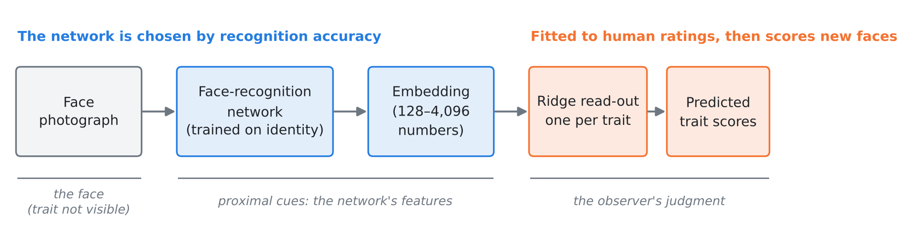
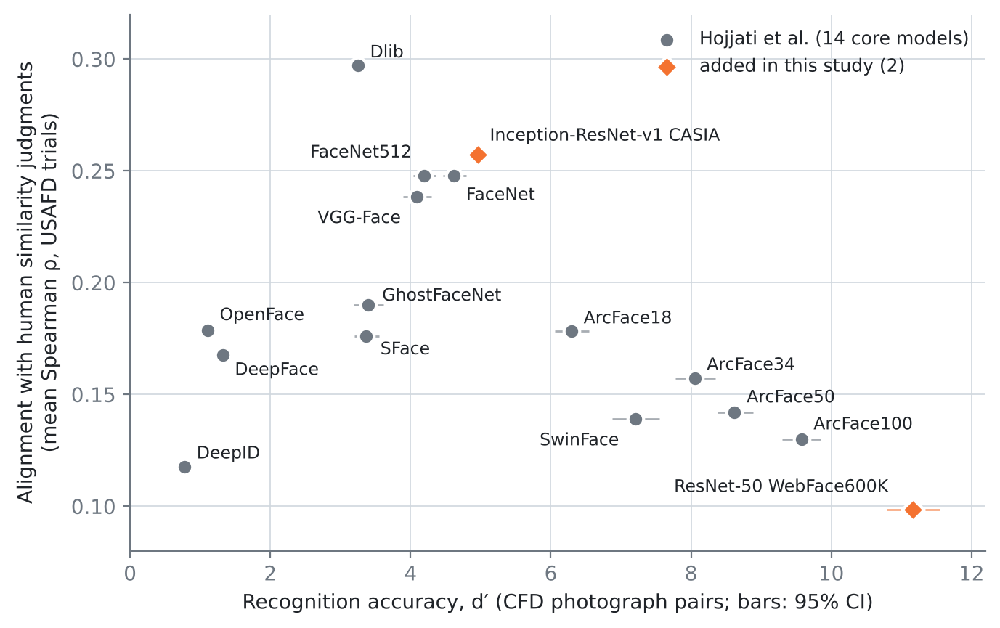

# Background and rationale

People form impressions of trustworthiness, competence or dominance from a face within a fraction of a second. These impressions are fast, largely automatic and often inaccurate, yet they influence hiring, voting, sentencing, partner choice and financial decisions (Freeman & Lin, 2025). Brunswik's (1956) lens model describes the process: an observer infers a hidden, distal attribute of a person from proximal cues that can be seen. In face perception the cues are visual features of the face, and the observer's judgment depends on how those cues are weighted and combined (Wieser & Brosch, 2012).

This page explains why the study asks its questions. It summarises the literature the project builds on, identifies the gap, and explains why the main outcome is defined relative to human judgments rather than in absolute terms. The questions and hypotheses themselves are stated on *Research questions and hypotheses*.

## Deep networks as a computational lens

Over the past decade, research on social perception has increasingly measured face impressions at scale with a fixed procedure. Face images are passed through a deep neural network (DNN) trained to recognise identities. The network's internal representation is then mapped to human ratings of a trait with regularised linear regression, one model per trait, and the fitted mapping is used to score new faces automatically (Parde et al., 2019; Keles, Lin, & Adolphs, 2021). Such scores have been applied to photographs of political candidates, dating profiles and job applicants. The procedure is a direct computational version of Brunswik's lens: the network's features stand in for the cues the observer uses.

*Figure 1. The standard procedure for measuring face impressions with a deep network, and its correspondence to Brunswik's lens model. The network is usually chosen for its recognition accuracy, although it is the read-out that is fitted to human ratings.*

The procedure is cheap and scalable, and the choice of network usually rests on a criterion that looks neutral: how accurately the network recognises faces. Behind this choice lies an assumption that has not been tested directly. The assumption is that a more accurate face-recognition network also provides a better representation for measuring social impressions.

## Three lines of evidence

Three independent lines of research, which have not been considered together, give reasons to doubt this assumption.

### Accuracy and human alignment are different properties

Hojjati et al. (2026) collected a large set of human similarity judgments for faces and compared them with the internal representations of many face-recognition networks, including Dlib, FaceNet, VGG-Face, ArcFace at several depths and SwinFace. Recognition accuracy and agreement with human similarity judgments (alignment) turned out to be related but distinct properties. Models with high but not the highest recognition performance, such as Dlib, FaceNet and VGG-Face, were the most aligned, whereas the most accurate models, ArcFace and SwinFace, were much less so. Beyond a certain level of performance, the two properties traded off. The same pattern appeared across processing stages within models, not only across models. Accuracy therefore cannot be taken as a proxy for how closely a network's representation resembles human face perception.

Hojjati et al. also derived a linear transformation that realigns a model's representation with human similarity judgments. The most accurate models benefited least from it, which the authors read as a deeper mismatch with human perception, and enforcing alignment lowered their recognition performance while slightly improving that of the weakest models. Fourteen of the face-recognition models in their study form the core of the present model set, extended by two further models (*Models*). Figure 2 shows the two properties for all 16.

*Figure 2. Alignment with human similarity judgments against recognition accuracy for the 16 models in this study. Grey: the 14 models of Hojjati et al.; orange: the two models added here. The most aligned models sit in the middle of the accuracy range. These values are inputs to the analysis, computed before registration; no outcome is shown.*

### DNN-based social measures have poor discriminant validity

Keles et al. (2021) established the regression framework described above and compared three kinds of features: a network trained for face recognition, a network trained for object recognition, and hand-crafted measurements of facial geometry. Network features predicted social judgments better than geometry. However, predictions from face-recognition features generalised to unrelated judgments: a measure built to predict trustworthiness also predicted judgments such as femininity or looking criminal, in some cases better than it predicted trustworthiness itself. In psychometric terms, such a measure lacks discriminant validity (Campbell & Fiske, 1959), because it is unclear which construct it measures. Keles et al. compared types of feature space. They did not examine whether differences in alignment among networks of the same type explain the problem, nor whether the leakage exceeds the entanglement already present in human ratings.

Treating a DNN-based predictor as a psychological measurement instrument, rather than only as a prediction model, follows a recent methodological argument. Freiesleben and Zezulka (2025) propose that machine-learning benchmarks should be examined for construct validity, as psychological tests are, before their scores support scientific claims. The present study applies this standard throughout.

### People entangle traits too

The tendency for judgments of unrelated traits to move together long predates computational models. Thorndike (1920) found that officers' ratings of soldiers on physique, intelligence, leadership and character correlated far more than independent qualities should, and named this the halo effect. Nisbett and Wilson (1977) showed that the effect operates without awareness: raters do not notice it even when asked directly. Entanglement is therefore a stable property of human social judgment, not only an artefact of measurement.

Hu, Heffner, Bhandari and FeldmanHall (2025) built a statistical face model that varies perceived attractiveness and trustworthiness independently, two traits that are strongly correlated in natural faces. Across three experiments (N = 249), people separated the two dimensions only when they had an explicit, relevant goal, such as judging trustworthiness, and how well they separated them predicted their behaviour in a trust game. When the goal was to judge attractiveness, irrelevant trustworthiness information biased the judgment. The ratings used in this study (Bainbridge, Isola, & Oliva, 2013) show the same pattern at scale: the 14 traits are highly intercorrelated (*Faces and human ratings*).

## The gap

The three lines meet at one question. If a computational measure shows entanglement between traits, how much of it reflects the holistic way people perceive faces, and how much is a defect of the instrument? Without an answer, the specificity of a DNN-based social measure cannot be interpreted.

The accuracy–alignment trade-off has been documented for face similarity but not for social judgments, so it is unknown whether it explains the validity problem that Keles et al. observed. The behavioural evidence on human entanglement has not been used as a baseline for computational measures. As a result, leakage in DNN instruments has been interpreted in absolute terms, without comparison to the entanglement in the human ratings the instruments are trained on.

This study addresses that gap with a relative measure. For each model it estimates how much a trait predictor leaks into other traits *beyond* what the human correlation between those traits, adjusted for how well each trait can be predicted, would produce (*Analysis plan*). The primary question (H1) is whether this excess leakage is lower in models that are more aligned with human face perception, holding recognition accuracy constant. A second confirmatory test (H1b) asks whether applying the alignment transformation of Hojjati et al. as a pre-processing step reduces excess leakage on faces the transformation was not trained on.

The question has practical consequences. Instruments used in political science, hiring research and online platforms may have been built on networks chosen for a criterion, recognition accuracy, that is not the most relevant one for the purpose. If accuracy and alignment are distinct, selecting networks by accuracy could produce instruments that differ in validity without any framework to detect or correct this.

## Secondary questions

Three exploratory questions extend the main analysis.

**Structure of impressions (Q2).** The dominant account of face evaluation reduces trait judgments to a few dimensions, mainly valence (trustworthiness) and dominance, obtained by principal component analysis of trait ratings (Oosterhof & Todorov, 2008). Freeman and Lin (2025) argue instead that impressions arise from a high-dimensional, dynamic space shaped by visual cues, conceptual associations and higher-order social cognition. On this view the low-dimensional structure partly reflects the measurement procedure, a fixed set of trait words reduced by PCA. The theory has not been tested against DNN representations that differ systematically in alignment, although it implies that alignment should matter. Q2 asks whether model predictions reproduce the human structure, or are more or less dimensional than it.

**Demographic differences (Q3).** Face-recognition and face-analysis networks do not encode demographic groups evenly. Serna et al. (2022) found large differences in recognition performance across groups in widely used networks, including VGG-Face and ArcFace, and differences in internal activation patterns within a single network. Gender classification systems show similar disparities (Buolamwini & Gebru, 2018), and accuracy-driven shortcut learning is a documented source of such gaps (Drozdowski et al., 2020). On the human side, the structure of impressions changes with the race and gender of the face judged (Freeman & Lin, 2025), and neural representations of gender, race and emotion are linked through overlapping stereotype associations (Stolier & Freeman, 2016). Whether representational disparities carry over into unequal social predictions is not known. Q3 asks whether prediction quality differs across race, gender and their combination, and whether this depends on alignment. Age is examined as well.

**Memorability (Q4).** Bainbridge et al. (2013) showed that some faces are reliably more memorable than others, and that memorability cannot be reduced to a combination of social impressions. It is therefore a useful contrast case: Q4 asks whether alignment matters for predicting an attribute of a face that is not itself a social impression.

## Scope

The study uses networks trained to recognise identities, because these are the networks the standard procedure relies on. Networks trained directly on social-trait labels, such as models of trustworthiness, dominance and IQ (McCurrie, Anthony, & Scheirer, 2017), warmth and competence (Messer & Fausser, 2019), psychological attributes including memorability (Grant et al., 2015) and attractiveness, trustworthiness and dominance (Peterson et al., 2022), are a natural extension but fall outside the present study.

## References

Bainbridge, W. A., Isola, P., & Oliva, A. (2013). The intrinsic memorability of face photographs. *Journal of Experimental Psychology: General, 142*(4), 1323–1334. https://doi.org/10.1037/a0033872

Brunswik, E. (1956). *Perception and the representative design of psychological experiments*. University of California Press.

Buolamwini, J., & Gebru, T. (2018). Gender shades: Intersectional accuracy disparities in commercial gender classification. *Proceedings of the 1st Conference on Fairness, Accountability and Transparency*, 77–91. https://proceedings.mlr.press/v81/buolamwini18a.html

Campbell, D. T., & Fiske, D. W. (1959). Convergent and discriminant validation by the multitrait-multimethod matrix. *Psychological Bulletin, 56*(2), 81–105. https://doi.org/10.1037/h0046016

Drozdowski, P., Rathgeb, C., Dantcheva, A., Damer, N., & Busch, C. (2020). Demographic bias in biometrics: A survey on an emerging challenge. *IEEE Transactions on Technology and Society, 1*(2), 89–103. https://doi.org/10.1109/TTS.2020.2992344

Freeman, J. B., & Lin, C. (2025). A high-dimensional model of social impressions. *Trends in Cognitive Sciences, 29*(9), 790–801. https://doi.org/10.1016/j.tics.2025.04.011

Freiesleben, T., & Zezulka, S. (2025). *The benchmarking epistemology: Construct validity for evaluating machine learning models* (arXiv:2510.23191). arXiv. https://doi.org/10.48550/arXiv.2510.23191

Grant, E., Sahm, S., Zabihi, M., & van Gerven, M. (2015). *Predicting and visualizing psychological attributions with a deep neural network*. arXiv. https://doi.org/10.48550/arXiv.1512.01289

Hojjati, S., Keshvari Ghadikolai, D., Shakeripour, A., Bahmani, Z., Shibata, K., Lau, H., & Moharramipour, A. (2026). *Trade-off between performance and human-like perception in face recognition models* [Preprint, version 4]. PsyArXiv. https://doi.org/10.31234/osf.io/bz3f9_v4. Data and code: https://doi.org/10.5281/zenodo.21867002

Hu, Y.-F., Heffner, J., Bhandari, A., & FeldmanHall, O. (2025). Goals bias face perception. *Journal of Experimental Psychology: General, 154*(3), 644–657. https://doi.org/10.1037/xge0001717

Keles, U., Lin, C., & Adolphs, R. (2021). A cautionary note on predicting social judgments from faces with deep neural networks. *Affective Science, 2*(4), 438–454. https://doi.org/10.1007/s42761-021-00075-5

McCurrie, M., Anthony, S., & Scheirer, W. J. (2017). Predicting first impressions with deep learning. *2017 12th IEEE International Conference on Automatic Face & Gesture Recognition (FG 2017)*. https://doi.org/10.1109/FG.2017.155

Messer, U., & Fausser, S. (2019). *Predicting social perception from faces: A deep learning approach* (arXiv:1907.00217). arXiv. https://doi.org/10.48550/arXiv.1907.00217

Nisbett, R. E., & Wilson, T. D. (1977). The halo effect: Evidence for unconscious alteration of judgments. *Journal of Personality and Social Psychology, 35*(4), 250–256. https://doi.org/10.1037/0022-3514.35.4.250

Oosterhof, N. N., & Todorov, A. (2008). The functional basis of face evaluation. *Proceedings of the National Academy of Sciences, 105*(32), 11087–11092. https://doi.org/10.1073/pnas.0805664105

Parde, C. J., Hu, Y., Castillo, C., Sankaranarayanan, S., & O'Toole, A. J. (2019). Social trait information in deep convolutional neural networks trained for face identification. *Cognitive Science, 43*(6), e12729. https://doi.org/10.1111/cogs.12729

Peterson, J., Griffiths, T., Uddenberg, S., Todorov, A., & Suchow, J. W. (2022). *Deep models of superficial face judgments*. SSRN. https://doi.org/10.2139/ssrn.4041458

Serna, I., Morales, A., Fierrez, J., & Obradovich, N. (2022). Sensitive loss: Improving accuracy and fairness of face representations with discrimination-aware deep learning. *Artificial Intelligence, 305*, 103682. https://doi.org/10.1016/j.artint.2022.103682

Stolier, R. M., & Freeman, J. B. (2016). Neural pattern similarity reveals the inherent intersection of social categories. *Nature Neuroscience, 19*(6), 795–797. https://doi.org/10.1038/nn.4296

Thorndike, E. L. (1920). A constant error in psychological ratings. *Journal of Applied Psychology, 4*(1), 25–29. https://doi.org/10.1037/h0071663

Wieser, M. J., & Brosch, T. (2012). Faces in context: A review and systematization of contextual influences on affective face processing. *Frontiers in Psychology, 3*, 471. https://doi.org/10.3389/fpsyg.2012.00471
