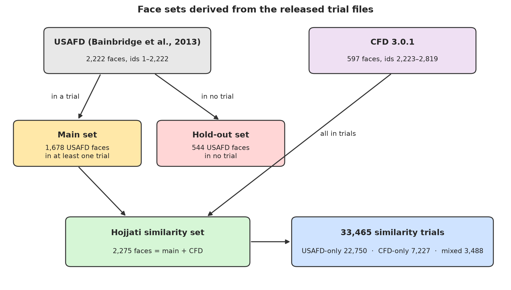
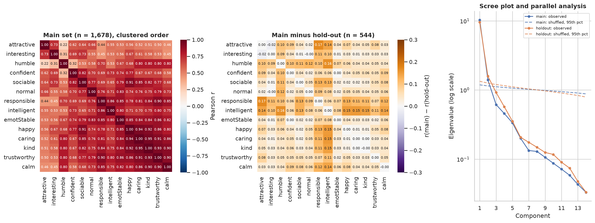

# Data and materials

This page covers the data used in this project. For repeatability and reliability, all related results are recomputed from the original files and checked against an expected value in [notebooks/01_data_and_release.ipynb](https://github.com/abdihere/Human-alignment-of-face-recognition-models-in-facial-social-impressions/blob/main/notebooks/01_data_and_release.ipynb).

---

## 1. Sources

None of the source data are redistributed. The repository tracks only a checksum list of the data files [`datasets/MANIFEST.sha256`](https://github.com/abdihere/Human-alignment-of-face-recognition-models-in-facial-social-impressions/blob/main/datasets/MANIFEST.sha256).

| Dataset                                                                                                                           | What the study uses                                                                                                                                                                            | Access                                              |
| --------------------------------------------------------------------------------------------------------------------------------- | ---------------------------------------------------------------------------------------------------------------------------------------------------------------------------------------------- | --------------------------------------------------- |
| Hojjati et al. (2026), Zenodo, [DOI 10.5281/zenodo.21867002](https://doi.org/10.5281/zenodo.21867002), version 2 (10 August 2026) | similarity trials with human rankings; embeddings of 14 models; recognition pairs; released splits; transformation code, training triplets and trained matrices                                | public (CC BY 4.0)                                  |
| Bainbridge, Isola & Oliva (2013), 10k US Adult Faces Database, 2,222-face annotated subset                                        | per-rater ratings of 20 attributes; perceived race, gender and age; memorability hit and false-alarm rates                                                                                     | from the database authors, under their terms of use |
| Chicago Face Database 3.0.1 (Ma, Correll & Wittenbrink, 2015)                                                                     | the 597 neutral photos used as similarity stimuli; the 1,207 photos in the recognition pairs; self-reported race and gender; ratings of attractive, trustworthy and happy; rater-estimated age | chicagofaces.org, under the CFD licence             |

### Input files

| group      | path                                                                                   | bytes     | sha256                                                             |
| ---------- | -------------------------------------------------------------------------------------- | --------- | ------------------------------------------------------------------ |
| zenodo     | `datasets/external/hojjati_zenodo/Split_data/All_Similarity_trials.npy`                | `1338728` | `bcd3c322550cc55f3c04e8b152bc5d52232c2ae9ae97a40ea5032ba4a4b325c9` |
| zenodo     | `datasets/external/hojjati_zenodo/Split_data/All_Similarity_scores.npy`                | `1338728` | `f9e5143a16246a389391bbb6fd47f98deee0b48ed0b29fd82cf02555b52ab762` |
| zenodo     | `datasets/external/hojjati_zenodo/Split_data/USAFD_Similarity_trials.npy`              | `910128`  | `dba968ceb1549fb29387efdcae9b493f8e9075861948ac2163290070b5c51d64` |
| zenodo     | `datasets/external/hojjati_zenodo/Split_data/USAFD_Similarity_scores.npy`              | `910128`  | `3ce48c2c372ad92166f27baccc826df72188737df09385f82552556749fde59a` |
| zenodo     | `datasets/external/hojjati_zenodo/Split_data/CFD_Similarity_trials.npy`                | `289208`  | `81da6db707fcdd55cc2ba1c017dbf494eb63c5fc77f60127bc5dee78f09273f2` |
| zenodo     | `datasets/external/hojjati_zenodo/Split_data/CFD_Similarity_scores.npy`                | `289208`  | `2cc87048a8d0eff214a0a251c5e98cd42c075a8978f744e00d178929301e49f0` |
| zenodo     | `datasets/external/hojjati_zenodo/Recognition_task_pairs/positive_pairs.npy`           | `526016`  | `011d389743fdfc3d8093e5086515731f0145da1b7dd3d7375249e8799def9294` |
| zenodo     | `datasets/external/hojjati_zenodo/Recognition_task_pairs/negative_pairs.npy`           | `4644128` | `a34c5d7047f0294c5403ed8933a393fc95408918e412088fa7b649520c685763` |
| zenodo     | `datasets/external/hojjati_zenodo/Models_alignment.pkl`                                | `1370`    | `eff13b353dbdd0fdc2a6b5dce8467658b6908c74faa9df5b49ca6a90f1c08c01` |
| zenodo     | `datasets/external/hojjati_zenodo/Trained_Ws_PCs/Note.txt`                             | `417`     | `fe839b5bd5507f36f6fab256cd311f65bb28d601b5a389cd4db602ea5c81bb37` |
| bainbridge | `datasets/raw/2kattributes/target-filenames.txt`                                       | `88007`   | `7fb61e5b1b6295eb5edc945a4c79928747c62be61d624b7f751c50b2afb121fc` |
| bainbridge | `datasets/raw/2kattributes/demographic & others labels/demographic-others-labels.xlsx` | `3213974` | `f5035bffe70096ab91094ce8a51efedeb6faaa2092a7fa1fd3ea0c704536c014` |
| bainbridge | `datasets/raw/2kattributes/psychology attributes/psychology-attributes.xlsx`           | `9873718` | `4d35e66ef4eb8bdcf25eeef98f79fe520f2a85dd416bbb1bd8d0bf41e1e63634` |
| bainbridge | `datasets/raw/2kmemorability/memorability-scores.xlsx`                                 | `202631`  | `61f2cd48c2c05eade2bc2d82f43e904a68b8f0ba333a30a5b4b6645e149022b8` |
| bainbridge | `datasets/raw/2kmemorability/target-filenames.txt`                                     | `88007`   | `7fb61e5b1b6295eb5edc945a4c79928747c62be61d624b7f751c50b2afb121fc` |
| cfd        | `datasets/raw/cfd/CFD 3.0.1 Norming Data and Codebook.xlsx`                            | `729832`  | `2e45a6fa4f27800cf99abeeb66565da8c1317da8bebd8a578b4deca78ebad3ae` |

---

## 2. Faces and face sets

**Face ids.** USAFD faces are ids 1–2,222 (id `i` = line `i` of `target-filenames.txt`). CFD faces are ids 2,223–2,819, in the order of the `Model` column of the CFD norming workbook.

**Similarity trials.** 33,465 trials. In each, a reference face is shown with four candidates, and participants ranked the candidates by similarity to the reference.

| Trial type | Trials     | With a repeated face |
| ---------- | ---------- | -------------------- |
| USAFD only | 22,750     | 774                  |
| CFD only   | 7,227      | 260                  |
| Mixed      | 3,488      | 139                  |
| **Total**  | **33,465** | **1,173**            |

**Face sets**, derived from the trial file:

| Set      | Definition                                      | Faces | Role                                                          |
| -------- | ----------------------------------------------- | ----- | ------------------------------------------------------------- |
| Main     | USAFD faces in at least one trial               | 1,678 | cross-validated analyses                                      |
| Hold-out | USAFD faces in no trial                         | 544   | faces unseen by the similarity data and by any transformation |
| CFD      | all CFD similarity faces (all appear in trials) | 597   | external check on three traits                                |

**Released cross-validation splits.** Hojjati et al.'s splits are made by trial, not by face. In each of the five outer folds, 33.5–35.4% of test faces also appear in training or validation trials of the same fold. The study builds its own face-level folds.

---

## 3. Human ratings

**Design.** About 15 workers rated each USAFD face on 20 attributes on a 1–9 scale, each attribute as a word and its opposite (e.g. _trustworthy_ and _untrustworthy_), in two survey forms. The ratings file has 33,430 rows: 15 per face, 16 for 100 faces. One worker (id 1236) contributed 1,464 rows.

**Trait score per face** = (mean rating of the word + (10 − mean rating of its opposite)) / 2, from the per-rater ratings.

**Analysis set.** The 14 personality and social traits of Oosterhof and Todorov (2008): attractive, calm, caring, confident, emotionally stable, happy, humble, intelligent, interesting, kind, normal, responsible, sociable, trustworthy. The other six attributes (memorable, typical, familiar, common, emotional, friendly) are used only in a Q2 sensitivity analysis.

**Reliability.** Split-half reliability with Spearman–Brown correction, all raters, mean of 200 random splits (seed 1).

|                     | Value                                                                       |
| ------------------- | --------------------------------------------------------------------------- |
| 14 traits           | mean 0.783; range 0.678 (intelligent) to 0.890 (happy); 13 of 14 above 0.70 |
| All 20 attributes   | mean 0.736; lowest familiar 0.464                                           |
| Without worker 1236 | lower for every attribute, by at most 0.033                                 |

| trait       | r_half | sb_spearman_brown | n_raters | sb_no1236 |
| ----------- | ------ | ----------------- | -------- | --------- |
| typical     | 0.376  | 0.547             | 1273     | 0.514     |
| memorable   | 0.427  | 0.598             | 1274     | 0.589     |
| emotStable  | 0.561  | 0.719             | 1274     | 0.706     |
| attractive  | 0.792  | 0.884             | 1274     | 0.877     |
| emotional   | 0.606  | 0.755             | 1274     | 0.737     |
| familiar    | 0.302  | 0.464             | 1273     | 0.453     |
| friendly    | 0.772  | 0.872             | 1273     | 0.865     |
| happy       | 0.802  | 0.890             | 1274     | 0.883     |
| responsible | 0.595  | 0.746             | 1274     | 0.739     |
| intelligent | 0.513  | 0.678             | 1271     | 0.676     |
| trustworthy | 0.662  | 0.796             | 1274     | 0.792     |
| common      | 0.358  | 0.528             | 1274     | 0.503     |
| confident   | 0.591  | 0.743             | 1271     | 0.729     |
| caring      | 0.751  | 0.858             | 1273     | 0.852     |
| calm        | 0.587  | 0.740             | 1274     | 0.736     |
| humble      | 0.645  | 0.784             | 1272     | 0.777     |
| interesting | 0.546  | 0.707             | 1274     | 0.697     |
| normal      | 0.591  | 0.743             | 1274     | 0.732     |
| kind        | 0.723  | 0.839             | 1273     | 0.836     |
| sociable    | 0.719  | 0.836             | 1273     | 0.830     |

**Trait structure** (14 traits):

|                                          | Main (1,678) | Hold-out (544) |
| ---------------------------------------- | ------------ | -------------- |
| Mean \|r\| between traits                | 0.709        | 0.646          |
| Pairs with \|r\| > 0.5 (of 91)           | 83           | 72             |
| Variance on the first component          | 73.8%        | 68.2%          |
| Components retained by parallel analysis | 2            | 2              |

The traits are close to one-dimensional: one general impression carries about three-quarters of the variation. This is why the outcome is defined _relative to_ the human entanglement (_Measures and analysis plan_).

**Memorability** (Bainbridge et al., Experiment 1): mean hit rate 51.6% (SD 12.6), mean false-alarm rate 14.4% (SD 8.7), mean d′ 1.20. Seven faces have a rate of 0 or 1. There are no rater-level data, so memorability has no reliability estimate.

---

## 4. Demographics

Race, gender and age are **perceived** labels: Bainbridge's per-face aggregate of 12 raters. Age is the mean of 12 five-level codes; it is analysed as a continuous score and binned below only for description.

|                                                 | All USAFD (2,222)              | Main (1,678)                   | Hold-out (544)               |
| ----------------------------------------------- | ------------------------------ | ------------------------------ | ---------------------------- |
| White                                           | 1,836                          | 1,402                          | 434                          |
| Non-White                                       | 386                            | 276                            | 110                          |
| — Black                                         | 220                            | 169                            | 51                           |
| — Hispanic                                      | 72                             | 45                             | 27                           |
| — East Asian                                    | 63                             | 42                             | 21                           |
| — Middle Eastern                                | 24                             | 15                             | 9                            |
| — South Asian                                   | 5                              | 5                              | 0                            |
| — Other                                         | 2                              | 0                              | 2                            |
| Female / male                                   | 953 / 1,269                    | 714 / 964                      | 239 / 305                    |
| Age <20 / 20–30 / 30–45 / 45–60 / 60+ / missing | 32 / 647 / 835 / 524 / 180 / 4 | 25 / 473 / 674 / 390 / 116 / 0 | 7 / 174 / 161 / 134 / 64 / 4 |

**Race × gender, main set** (female / male): White 599 / 803; non-White 115 / 161.

**Main vs hold-out.** The sets differ in age (χ²(4) = 26.7, p = 2.3 × 10⁻⁵) and race (χ²(4) = 12.2, p = 0.016; small groups merged), not in gender (p = 0.61). The hold-out is a test on a somewhat different sample.

**Contrasts used.** Female vs male, White vs non-White, their 2 × 2 combination, and age. Smaller race groups are described only.

---

## 5. Chicago Face Database

- 597 similarity faces, matched to ids 2,223–2,819. The recognition test uses 1,207 CFD photos of 566 identities (597 neutral and 610 with expressions).
- Self-reported race and gender (female / male): Black 104 / 93, White 90 / 93, Asian 57 / 52, Latino 56 / 52.
- Age: rater-estimated only (mean 28.9 years, SD 6.3); self-reported age is empty.
- Traits shared with Bainbridge: attractive, trustworthy, happy (means on 1–7: 3.23, 3.43, 2.42).
- CFD raters judged each face **relative to people of the same race and gender**. CFD ratings are therefore used only as correlations within race-and-gender cells, never for differences between groups, and never on Bainbridge's scale.

---

## References

Bainbridge, W. A., Isola, P., & Oliva, A. (2013). The intrinsic memorability of face photographs. _Journal of Experimental Psychology: General, 142_(4), 1323–1334.

Hojjati, [authors] (2026). [Title]. Data and code: <https://doi.org/10.5281/zenodo.21867002> (version 2).

Ma, D. S., Correll, J., & Wittenbrink, B. (2015). The Chicago Face Database: A free stimulus set of faces and norming data. _Behavior Research Methods, 47_(4), 1122–1135.

Oosterhof, N. N., & Todorov, A. (2008). The functional basis of face evaluation. _Proceedings of the National Academy of Sciences, 105_(32), 11087–11092.
