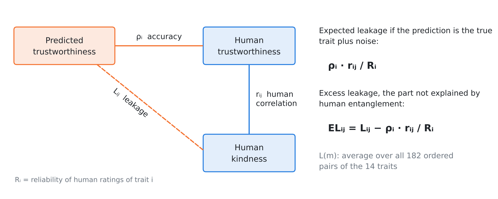
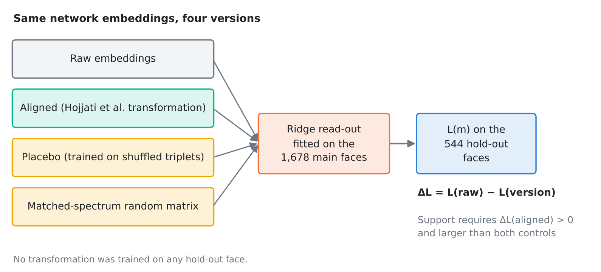

# Research questions and hypotheses

The study has one confirmatory hypothesis (H1), one preregistered secondary hypothesis (H1b), three exploratory questions (Q2–Q4) and one descriptive check. The unit of analysis is the model: each of the 16 face-recognition models (*Models*) contributes one value of each measure. This page states each question, the reasoning behind it, the prediction and the rule by which it will be judged. The measures are defined in full on *Analysis plan*; the three that recur throughout are summarised here.

- **Alignment** is how closely a model's representation agrees with human judgments of face similarity: the mean Spearman correlation between the model's and the participant's ranking of four candidate faces, over the similarity trials of Hojjati et al. (2026).
- **Recognition accuracy** is d′ for telling apart same-identity and different-identity photograph pairs from the Chicago Face Database.
- **Excess leakage, L(m),** is the extent to which a model's prediction of one trait also tracks other traits, beyond what the correlations between those traits in human ratings, adjusted for the model's accuracy on each trait, would produce. A value of zero means the model's predictions are exactly as entangled as the human ratings imply; positive values mean they are more entangled.

*Figure 1. Excess leakage for one pair of traits. A model's trustworthiness prediction is expected to track human kindness ratings to some degree, because people's trustworthiness and kindness ratings are correlated. Excess leakage is the part of the observed leakage that this expectation does not explain.*

## H1: Alignment and excess leakage (confirmatory)

**Question.** Do models that are more aligned with human face perception produce social-trait predictions with less excess leakage, independent of their recognition accuracy?

**Rationale.** A trait predictor built on a network's representation can only use the information that representation contains. A network optimised for identity recognition may come to rely on features that separate identities efficiently but play little role in how people perceive faces. A read-out trained to predict trustworthiness from such a space will pick up whatever features happen to covary with trustworthiness in the training faces, and these features may also covary with other traits, producing leakage. A representation closer to human perception should instead contain the cues people themselves use, so that a trustworthiness predictor tracks other traits roughly as much as human trustworthiness ratings do, and no more. This reasoning predicts lower excess leakage for more aligned models.

Two covariates are needed for the test to address alignment specifically. Recognition accuracy enters with a quadratic term, because alignment and accuracy are related by an inverted U (Hojjati et al., 2026); without this control an alignment effect could not be separated from an accuracy effect. Mean trait-prediction accuracy enters because a model that predicts traits well may also leak differently for reasons unrelated to alignment.

**Prediction.** In a regression of L(m) on alignment, recognition accuracy, its square and mean trait accuracy, the coefficient for alignment is negative.

**Decision rule.** H1 is supported only if all three conditions hold.

| | Condition | What it protects against |
|---|---|---|
| 1 | The wild cluster bootstrap-t p-value for the alignment coefficient is below 0.025 (one-sided, lower tail; the 12 model families as clusters; 9,999 draws) | chance, given only 16 models and dependence among models of the same family |
| 2 | The alignment coefficient is negative in each of the 12 refits that leave out one family | a result driven by a single family |
| 3 | The alignment coefficient is negative when L(m) is measured on the 544 hold-out faces | a result specific to the faces used in model fitting |

Otherwise H1 is not supported. If condition 1 holds but condition 2 or 3 fails, the report says so and names the family or the hold-out set responsible. The three conditions are deliberately conservative. With one observation per model and 12 clusters, a single p-value is fragile, and the study would rather miss a weak relation than report one that depends on one family or one set of faces.

**Reported alongside, outside the rule:** all coefficients with cluster-robust standard errors, the partial-regression plot, and the same model with uncorrected L(m), with a human baseline computed from independent raters (a check on rater-level halo), and with alignment computed on all similarity trials.

## H1b: The alignment transformation (secondary)

**Question.** Does applying Hojjati et al.'s alignment transformation to a model's embeddings, before predicting traits, reduce excess leakage on faces the transformation has never seen?

**Rationale.** H1 is correlational: models differ in many ways besides alignment. H1b changes alignment within each model while holding the network fixed, and so comes closer to testing whether alignment itself matters. It also has a practical side. If the transformation lowers leakage, it offers a simple pre-processing step for existing instruments, without retraining the network.

**Prediction.** ΔL = L(raw) − L(aligned) is greater than zero on the 544 hold-out faces, which appear in no similarity trial and therefore played no part in training any transformation.

**Test.** A one-sided Wilcoxon signed-rank test of ΔL over the 16 models (α = 0.05), with a family-clustered bootstrap 95% interval for mean ΔL.

**Controls.** A reduction in leakage could come from transforming the embeddings at all, rather than from what the transformation learned about human similarity. Two control transformations are therefore applied in the same way: a placebo trained with the same code on similarity triplets whose order has been flipped at random, and a matrix with the same singular values as the real transformation but random directions. The transformation is credited with lowering leakage only if ΔL is positive *and* larger than under both controls.

*Figure 2. Design of H1b. Each model's embeddings are used in four versions; for each, a read-out is fitted on the main faces and excess leakage is measured on the hold-out faces.*

**Manipulation check.** The transformation must raise alignment on similarity trials it was not trained on. If it does not, H1b is reported as not tested, because the manipulation did not take place. A five-fold cross-validated version of the analysis on the main faces is reported as supporting evidence.

## Exploratory questions

Q2–Q4 are reported as estimates with 95% intervals. No p-values are used to make claims about them, and no result is described as confirming anything. The direction each question would take under the theory is stated in advance so that the results can be read against it.

**Q2. Does the structure of predicted impressions become richer as alignment rises?** Freeman and Lin (2025) argue that the familiar two-dimensional structure of face impressions partly reflects how impressions are measured. If so, predictions from more human-like representations might show richer structure than predictions from less aligned ones. Because prediction error by itself changes how many dimensions a set of scores appears to have, each model's structure is compared with a noise-matched null: the human ratings degraded to the model's level of accuracy. Reported: the association of alignment with richness beyond noise (effective rank), the excess share of the first component, and congruence with the human structure. Expected direction: positive for richness.

**Q3. Are predictions more demographically uneven than people's ratings, and does this shrink as alignment rises?** Face-recognition networks encode demographic groups unevenly (Serna et al., 2022), but the human ratings themselves differ between groups. The question is therefore whether the gaps in predicted scores between women and men, White and non-White faces, and across age exceed the gaps in the human ratings of the same faces. Reported: a per-model disparity index and its association with alignment; race × gender cells are described. Expected direction: negative (less excess disparity in more aligned models).

**Q4. Does alignment matter differently for memorability?** Memorability is a stable property of faces that cannot be reduced to social impressions (Bainbridge et al., 2013). If alignment matters because it preserves the cues behind social impressions, its association with prediction accuracy should be weaker for memorability than for the social traits. Memorability is classified as *distinct* if its association with alignment falls below the 25th percentile of the associations for the 14 traits, and *not distinct* otherwise. Expected: distinct.

**Descriptive check on the Chicago Face Database.** Predictions for attractiveness, trustworthiness and happiness, from models fitted on the USAFD faces, are compared with the CFD's own ratings, to see whether the trait predictors carry over to a separate set of photographs and raters. Because CFD raters judged faces relative to others of the same race and gender, correlations are computed within race × gender cells and pooled. No decision depends on it.

## What the results can and cannot show

| Result | What it supports | What it does not |
|---|---|---|
| H1 supported | Among these 16 models, more aligned models leak less, beyond recognition and trait accuracy, robust to leaving out any family and replicated in direction on new faces | that alignment causes lower leakage, or that the relation holds for other models or faces |
| H1 not supported, coefficient negative | a relation in the predicted direction that the study could not establish | that no relation exists; power is limited (*Sensitivity and validation*) |
| H1 not supported, coefficient positive | no support for the hypothesis | a confirmed reverse relation, which was not tested |
| Condition 1 met, 2 or 3 failed | an association that depends on one family or does not carry over to new faces | H1 |
| H1b: ΔL > 0 and larger than both controls | the transformation lowers leakage on unseen faces because of what it learned from human similarity judgments | that every use of the transformation helps |
| H1b: ΔL > 0, not larger than the controls | transforming the embeddings lowers leakage, but not because of alignment | an alignment effect |
| Q2–Q4 | estimates that suggest directions for further work | confirmation of anything |

All conclusions are limited to the models, faces and raters studied: 16 identity-recognition models, photographs of mostly White US adults, and ratings by US online workers. The limits of the data are discussed on *Faces and human ratings* and *Contingencies, existing data and deviations*.

## References

Bainbridge, W. A., Isola, P., & Oliva, A. (2013). The intrinsic memorability of face photographs. *Journal of Experimental Psychology: General, 142*(4), 1323–1334. https://doi.org/10.1037/a0033872

Freeman, J. B., & Lin, C. (2025). A high-dimensional model of social impressions. *Trends in Cognitive Sciences, 29*(9), 790–801. https://doi.org/10.1016/j.tics.2025.04.011

Hojjati, S., Keshvari Ghadikolai, D., Shakeripour, A., Bahmani, Z., Shibata, K., Lau, H., & Moharramipour, A. (2026). *Trade-off between performance and human-like perception in face recognition models* [Preprint, version 4]. PsyArXiv. https://doi.org/10.31234/osf.io/bz3f9_v4

Serna, I., Morales, A., Fierrez, J., & Obradovich, N. (2022). Sensitive loss: Improving accuracy and fairness of face representations with discrimination-aware deep learning. *Artificial Intelligence, 305*, 103682. https://doi.org/10.1016/j.artint.2022.103682
