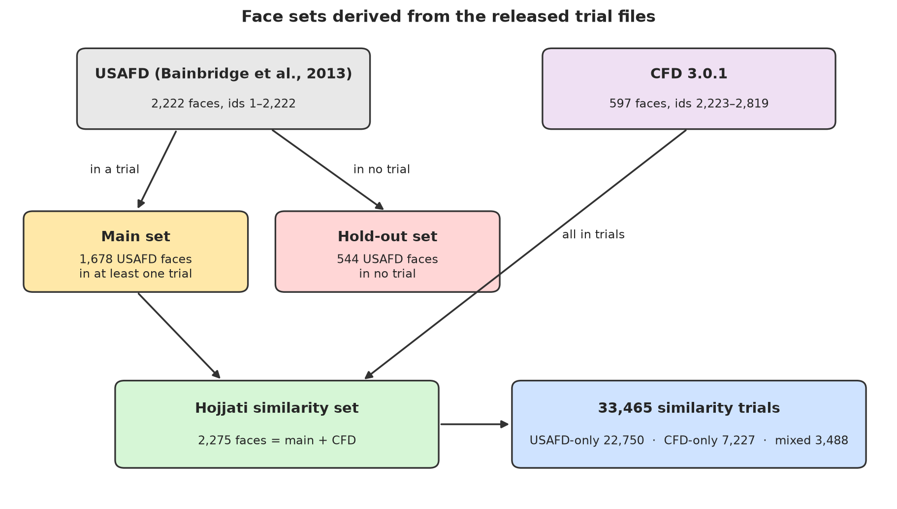
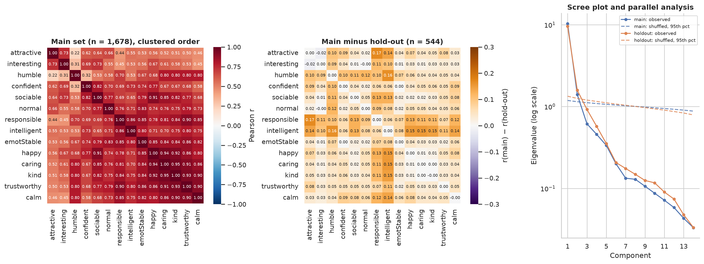
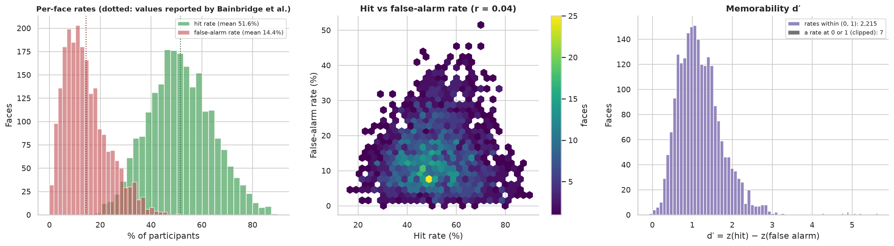
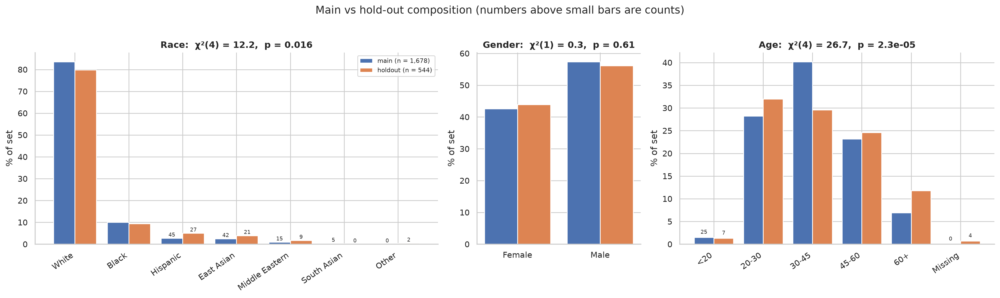

# Faces and human ratings

The study uses existing data only. Faces and their social ratings come from the 10k US Adult Faces Database (Bainbridge, Isola, & Oliva, 2013); human similarity judgments and the model embeddings come from Hojjati et al. (2026); the Chicago Face Database (Ma, Correll, & Wittenbrink, 2015) supplies additional stimuli and an external check. This page describes the faces, how the ratings were collected and scored, and the properties of the data that shape the analysis. Every number below is recomputed from the original files in `notebooks/01_data_and_release.ipynb`, which checks each value against an expected one. File checksums and access terms are listed on *Reproducibility*.

## Faces

The core stimulus set is the 2,222 faces of the annotated subset of the 10k US Adult Faces Database (USAFD). These are photographs of adult faces collected from the web. Hojjati et al. added the 597 neutral-expression photographs of the Chicago Face Database (CFD 3.0.1), giving 2,819 faces in total. Faces are numbered 1–2,222 (USAFD, in the order of the database's `target-filenames.txt`) and 2,223–2,819 (CFD, in the order of the norming workbook).

## Similarity judgments

Hojjati et al. collected 33,465 similarity trials. In each, a participant saw a reference face and four candidates, and ranked the candidates by how similar they looked to the reference. Of these, 22,750 trials contain only USAFD faces, 7,227 only CFD faces and 3,488 both. In 1,173 trials one face appears twice; these are kept, as in the original release. These rankings define each model's alignment (*Models*).

Not every USAFD face appears in a similarity trial. This splits the USAFD faces into two sets that play different roles in the analysis:

| Set | Faces | Definition | Role |
|---|---|---|---|
| Main | 1,678 | USAFD faces in at least one trial | cross-validated analyses |
| Hold-out | 544 | USAFD faces in no trial | a test on faces that no similarity judgment, and no transformation trained on them, has seen |
| CFD | 597 | all CFD faces (all are in trials) | external check on three traits |

*Figure 1. How the 2,819 faces divide into the main, hold-out and CFD sets.*

Hojjati et al.'s released cross-validation splits divide *trials*, not faces: in each of their five outer folds, 33.5–35.4% of the test faces also appear in training or validation trials. Because our outcome is measured on faces, the study builds its own face-level folds (*Analysis plan*).

## Social ratings

Bainbridge et al. collected ratings on Amazon Mechanical Turk. About 15 workers rated each face on 20 attributes, on a 1–9 scale, with each attribute presented both as a word and as its opposite (for example *trustworthy* and *untrustworthy*) across two survey forms. The file holds 33,430 rating rows: 15 per face, and 16 for 100 faces. One worker contributed 1,464 rows; removing this worker lowers reliability by at most 0.033 for any attribute, so all workers are kept.

For each face and attribute, the score is the average of the word's mean rating and the reversed mean rating of its opposite: (word + (10 − opposite)) / 2. Scores are rebuilt from the individual ratings rather than taken from the database's summary sheet; the two differ by up to 0.47 for single faces (95th percentile 0.08).

The analysis uses the 14 personality and social traits that Oosterhof and Todorov (2008) used to describe the structure of face evaluation: attractive, calm, caring, confident, emotionally stable, happy, humble, intelligent, interesting, kind, normal, responsible, sociable and trustworthy. The six remaining attributes (common, emotional, familiar, friendly, memorable, typical) enter only a sensitivity analysis of Q2.

### Reliability

Reliability was estimated by splitting the raters of each face into two random halves, correlating the half-scores across faces and applying the Spearman–Brown correction, averaged over 200 splits. The 14 traits are reliable enough for the analysis (mean 0.78; 13 of 14 above 0.70), though not uniformly so. These values enter the outcome measure directly, as each trait's ceiling (*Analysis plan*).

| Trait | Reliability | | Trait | Reliability |
|---|---|---|---|---|
| happy | 0.890 | | humble | 0.784 |
| attractive | 0.884 | | responsible | 0.746 |
| caring | 0.858 | | confident | 0.743 |
| kind | 0.839 | | normal | 0.743 |
| sociable | 0.836 | | calm | 0.740 |
| trustworthy | 0.796 | | emotionally stable | 0.719 |
| | | | interesting | 0.707 |
| | | | intelligent | 0.678 |

The six other attributes are less reliable (0.46–0.87; lowest *familiar*). Per-attribute values, including the analysis without the prolific worker, are in `results/data/reliability.csv`.

### The traits are strongly entangled

Impressions of different traits are highly correlated. On the main set the average absolute correlation between two traits is 0.71, 83 of the 91 trait pairs correlate above 0.5, and the first principal component carries 74% of the variance (hold-out: 0.65, 72 pairs and 68%). Parallel analysis retains two components in both sets, one of them clearly dominant.

*Figure 2. Correlations between the 14 traits across the main-set faces.*

This entanglement is the reason the study's outcome is defined *relative to* people's own ratings. A model that predicts trustworthiness will inevitably also track kindness, because people's judgments of the two move together. What the study asks is whether a model's predictions are more entangled than the human ratings themselves (*Analysis plan*).

## Memorability

Bainbridge et al. (2013, Experiment 1) measured how memorable each face is in a repeat-detection task. Across faces, the mean hit rate is 51.6% (SD 12.6), the mean false-alarm rate 14.4% (SD 8.7) and the mean d′ 1.20. Seven faces have a rate of exactly 0 or 1. Only per-face rates are available, so memorability has no reliability estimate; this limits how it can be compared with the social traits in Q4.

*Figure 3. Per-face memorability. Left: hit and false-alarm rates (dotted lines: means reported by Bainbridge et al.). Middle: the two rates are nearly unrelated across faces. Right: memorability d′.*

## Demographics

Race, gender and age are **perceived** labels: for each face, the aggregate judgment of 12 raters in Bainbridge et al.'s data. They describe how a face was seen, not how the person identifies. Age is the mean of twelve five-level codes and is analysed as a continuous score.

The sample is mostly White (83%) and somewhat more often male (57%). Non-White groups are small: in the main set, 169 faces are perceived as Black, 45 as Hispanic, 42 as East Asian, 15 as Middle Eastern and 5 as South Asian. Group comparisons are therefore limited to female vs male, White vs non-White, their 2 × 2 combination (main set: White 599 female / 803 male; non-White 115 / 161) and age. Smaller groups are described but not compared.

| | All USAFD | Main | Hold-out |
|---|---|---|---|
| Faces | 2,222 | 1,678 | 544 |
| White / non-White | 1,836 / 386 | 1,402 / 276 | 434 / 110 |
| Female / male | 953 / 1,269 | 714 / 964 | 239 / 305 |
| Age < 20 / 20–30 / 30–45 / 45–60 / 60+ | 32 / 647 / 835 / 524 / 180 | 25 / 473 / 674 / 390 / 116 | 7 / 174 / 161 / 134 / 64 |

The hold-out set is not a random sample of the faces: it differs from the main set in age (χ²(4) = 26.7, p < .001) and race (χ²(4) = 12.2, p = .016), but not in gender (p = .61). Results on the hold-out are therefore a test of generalisation to a somewhat different sample, not a pure replication.

*Figure 4. Composition of the main and hold-out sets by perceived race, gender and age band. Numbers above small bars are counts.*

## Chicago Face Database

The 597 CFD faces were photographed under standardised conditions, with self-reported race and gender (Black 197, White 183, Asian 109, Latino 108; 307 female). Three of their norming ratings overlap with Bainbridge's attributes: attractive, trustworthy and happy (on a 1–7 scale). CFD raters were asked to judge each face relative to other people of the same race and gender, so the ratings carry no information about differences between groups. They are used only as correlations within race-and-gender cells, as an external check on the models' trait predictions. A further 1,207 CFD photographs of 566 people (neutral and expressive) form the face-recognition test that defines each model's recognition accuracy (*Models*).

## References

Bainbridge, W. A., Isola, P., & Oliva, A. (2013). The intrinsic memorability of face photographs. *Journal of Experimental Psychology: General, 142*(4), 1323–1334.

Hojjati, S., Keshvari Ghadikolai, D., Shakeripour, A., Bahmani, Z., Shibata, K., Lau, H., & Moharramipour, A. (2026). *Trade-off between performance and human-like perception in face recognition models* [Preprint, version 4]. PsyArXiv. https://doi.org/10.31234/osf.io/bz3f9_v4. Data and code: https://doi.org/10.5281/zenodo.21867002 (version 2).

Ma, D. S., Correll, J., & Wittenbrink, B. (2015). The Chicago Face Database: A free stimulus set of faces and norming data. *Behavior Research Methods, 47*(4), 1122–1135.

Oosterhof, N. N., & Todorov, A. (2008). The functional basis of face evaluation. *Proceedings of the National Academy of Sciences, 105*(32), 11087–11092.
