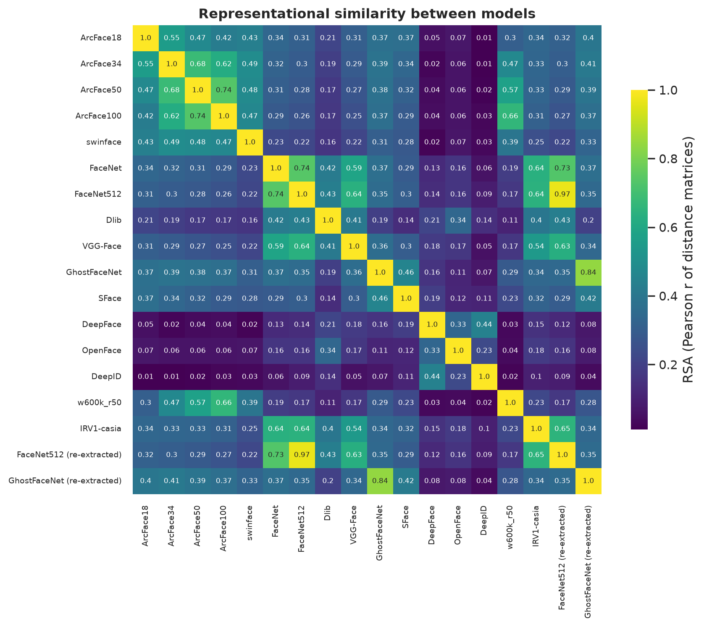

# Models

The study compares 16 face-recognition models from 12 families. Fourteen are the face-recognition models examined by Hojjati et al. (2026), whose embeddings are taken from their public release. Two further networks were added for this study and their embeddings extracted here. This page explains how the set was chosen, how the embeddings were obtained, and how the two model-level predictors, alignment and recognition accuracy, are measured. The values below are computed in `notebooks/01_data_and_release.ipynb` (core models) and `notebooks/02_extension_models.ipynb` (extensions). Weight files, checksums and licences are listed on *Reproducibility*.

## Choosing the models

H1 is a comparison across models, so the model set determines what the study can detect. Two properties matter: the models should differ in alignment and in recognition accuracy, and those differences should not be too closely tied to each other, since H1 asks about alignment with accuracy held constant.

**Core models.** All 14 face-recognition models in the Hojjati et al. release are included. They cover a wide range of both properties, from DeepID (low accuracy, low alignment) through Dlib (moderate accuracy, the highest alignment) to the ArcFace and SwinFace models (high accuracy, low alignment). Using the released embeddings means alignment is computed from exactly the representations Hojjati et al. analysed, and the alignment transformation for H1b exists for each of them. The release also contains two models that are not face-recognition networks: an active appearance model, which was fitted to the 544 faces that form this study's hold-out set, and StyleGAN2, a generative model. Both are excluded.

**Extension models.** With one value per model, each added model increases the information available to H1. Two openly available networks were added:

- **ResNet-50 trained on WebFace600K** (InsightFace `w600k_r50`), an ArcFace-type network trained on a different and larger dataset than the core ArcFace models. It extends the top of the accuracy range.
- **Inception-ResNet-v1 trained on CASIA-WebFace** (`IRV1-casia`), the FaceNet architecture trained on a different dataset with a softmax loss. It falls in the middle of the accuracy range with high alignment.

The two models raise the estimated power of H1 by about 8–9 percentage points (*Sensitivity and validation*). Before inclusion, each candidate was checked against every model already in the set to make sure it is not a copy of one of them (below).

**Families.** Models that share an architecture lineage and training data are not independent observations. They are grouped into families, which serve as clusters in the H1 inference: the four ArcFace depths form one family, FaceNet and FaceNet512 form another, and every other model is its own family.

| Model | Family | Embeddings | Size |
|---|---|---|---|
| ArcFace-18, -34, -50, -100 (Glint360K) | ArcFace | release | 512 |
| SwinFace | SwinFace | release | 512 |
| FaceNet, FaceNet512 | FaceNet | release | 128, 512 |
| Dlib | Dlib | release | 128 |
| VGG-Face | VGG-Face | release | 4,096 |
| GhostFaceNet | GhostFaceNet | release | 512 |
| SFace | SFace | release | 128 |
| DeepFace | DeepFace | release | 4,096 |
| OpenFace | OpenFace | release | 128 |
| DeepID | DeepID | release | 160 |
| ResNet-50 WebFace600K (`w600k_r50`) | R50-WebFace600K | extracted here | 512 |
| Inception-ResNet-v1 CASIA (`IRV1-casia`) | IRV1-CASIA | extracted here | 512 |

## Embeddings

**Core models.** The Zenodo release (version 2) contains, for each model, the embeddings of all 2,819 stimulus faces in face-id order and of the 1,207 Chicago Face Database photographs used for the recognition test. Hojjati et al. extracted them with the deepface library, using RetinaFace detection and alignment.

**Extension models.** Embeddings were extracted from the same images. To confirm that our copies of the images and their ids match the authors', two core models (FaceNet512 and GhostFaceNet) were first re-extracted with the authors' pipeline. Their alignment matched the released values to within 0.0002, and their recognition accuracy was identical.

Faces were detected once per image with RetinaFace, taking the highest-scoring face at a confidence threshold of 0.9, then 0.5, and using the whole image if neither found a face. Of the 2,819 stimuli, 2,758 were detected at 0.9, 36 at 0.5 and 25 not at all; of the 1,207 recognition photographs, 1,203 at 0.9 and 4 at 0.5. Each network then received the crop and pixel scaling it was trained with: a five-landmark alignment to 112 × 112 pixels for the ResNet-50, and a square 160 × 160 crop for the Inception-ResNet-v1.

The extensions therefore use each network's own preprocessing, not the deepface pipeline used for the core models. This is a disclosed difference (*Contingencies, existing data and deviations*). The leave-one-family-out condition of H1 guards against a result that depends on either extension.

## The copy check

A network that duplicates a model already in the set would add a row to the regression without adding information, and would make the inference overconfident. Each candidate was compared with every model in the set in two ways.

- **Representational similarity (RSA):** the correlation between two models' face-to-face distance matrices over the 2,819 faces. It measures whether two models organise faces similarly.
- **Row-wise cosine:** for models with embeddings of the same size, the cosine between the two embeddings of each face. It is high only when two networks share weights, because unrelated networks place faces in unrelated coordinate systems.

A candidate counts as a duplicate if RSA is at least 0.98, or if the median row-wise cosine is at least 0.5. The cosine rule was added after the first run showed that RSA alone could not flag even a model compared with its own re-extraction (RSA 0.97 for FaceNet512, 0.84 for GhostFaceNet), because small differences in preprocessing change the distance matrices. Median cosine, in contrast, is above 0.99 for the same weights and between −0.01 and 0.03 for every pair of different networks. The rule change is recorded as a deviation (*Contingencies, existing data and deviations*).

Both extensions passed. ResNet-50 WebFace600K is closest to ArcFace-100 (RSA 0.66; median cosine −0.0005), and Inception-ResNet-v1 CASIA is closest to FaceNet512 (RSA 0.64; median cosine 0.02).

*Figure 1. Representational similarity between all models, including the two re-extracted core models used to check the pipeline (bottom rows). Models of the same family are moderately similar (ArcFace depths 0.42–0.74); a model and its own re-extraction reach 0.84–0.97.*

## Alignment

Alignment measures how closely a model's sense of face similarity matches people's. In each similarity trial, the model ranks the four candidate faces by their distance to the reference face (Euclidean distance between L2-normalised embeddings), and this ranking is compared with the participant's by Spearman's ρ. Alignment is the mean ρ over trials. For the core models, the values reproduce those released by Hojjati et al. exactly.

The H1 predictor is alignment on the 22,750 trials that contain only USAFD faces, because the outcome is measured on USAFD faces and alignment on Chicago Face Database photographs, which are standardised and expressionless, is systematically higher. Alignment on all 33,465 trials is used as a sensitivity analysis.

## Recognition accuracy

Recognition accuracy measures how well a model tells whether two photographs show the same person. It is computed on 1,494 same-identity and 13,500 different-identity pairs of CFD photographs from 566 people, with cosine similarity as the score. Accuracy is expressed as d′, the distance between the same-identity and different-identity score distributions in units of their pooled standard deviation, with 95% intervals from 2,000 bootstrap resamples of identities. The more familiar area under the ROC curve is not used because it is at or near 1.0 for five models and so cannot separate them.

| Model | Family | Alignment (USAFD trials) | Alignment (all trials) | d′ [95% CI] |
|---|---|---|---|---|
| ResNet-50 WebFace600K | R50-WebFace600K | 0.098 | 0.115 | 11.16 [10.79, 11.55] |
| ArcFace-100 | ArcFace | 0.130 | 0.145 | 9.57 [9.30, 9.85] |
| ArcFace-50 | ArcFace | 0.142 | 0.159 | 8.62 [8.38, 8.88] |
| ArcFace-34 | ArcFace | 0.157 | 0.172 | 8.05 [7.78, 8.34] |
| SwinFace | SwinFace | 0.139 | 0.152 | 7.20 [6.88, 7.55] |
| ArcFace-18 | ArcFace | 0.178 | 0.199 | 6.30 [6.06, 6.55] |
| Inception-ResNet-v1 CASIA | IRV1-CASIA | 0.257 | 0.269 | 4.96 [4.80, 5.12] |
| FaceNet | FaceNet | 0.248 | 0.264 | 4.62 [4.46, 4.79] |
| FaceNet512 | FaceNet | 0.248 | 0.263 | 4.19 [4.04, 4.35] |
| VGG-Face | VGG-Face | 0.238 | 0.260 | 4.09 [3.90, 4.30] |
| GhostFaceNet | GhostFaceNet | 0.190 | 0.207 | 3.39 [3.19, 3.62] |
| SFace | SFace | 0.176 | 0.196 | 3.37 [3.20, 3.55] |
| Dlib | Dlib | 0.297 | 0.321 | 3.25 [3.16, 3.33] |
| DeepFace | DeepFace | 0.168 | 0.201 | 1.32 [1.23, 1.43] |
| OpenFace | OpenFace | 0.179 | 0.212 | 1.11 [1.02, 1.19] |
| DeepID | DeepID | 0.118 | 0.152 | 0.78 [0.67, 0.88] |

## How alignment and accuracy relate in this set

Across the 16 models, alignment rises and then falls as accuracy increases (Figure 2 on *Background and rationale*). Accuracy and its square together explain 57% of the variance in alignment (variance inflation factor 2.3), and the rank correlation between alignment and d′ is −0.37. H1 controls for both terms, so its test rests on the remaining 43% of the variance in alignment, the part not predictable from accuracy. This is the main reason the study's power is limited, and it is taken into account in the power analysis (*Sensitivity and validation*).

Both predictors were computed before registration. They involve no social rating and no outcome measure, so knowing them does not reveal anything about the results.

## References

Hojjati, S., Keshvari Ghadikolai, D., Shakeripour, A., Bahmani, Z., Shibata, K., Lau, H., & Moharramipour, A. (2026). *Trade-off between performance and human-like perception in face recognition models* [Preprint, version 4]. PsyArXiv. https://doi.org/10.31234/osf.io/bz3f9_v4. Data and code: https://doi.org/10.5281/zenodo.21867002 (version 2).

Yi, D., Lei, Z., Liao, S., & Li, S. Z. (2014). *Learning face representation from scratch*. arXiv. https://doi.org/10.48550/arXiv.1411.7923

Zhu, Z., Huang, G., Deng, J., Ye, Y., Huang, J., Chen, X., Zhu, J., Yang, T., Lu, J., Du, D., & Zhou, J. (2021). WebFace260M: A benchmark unveiling the power of million-scale deep face recognition. *Proceedings of the IEEE/CVF Conference on Computer Vision and Pattern Recognition*, 10492–10502.
