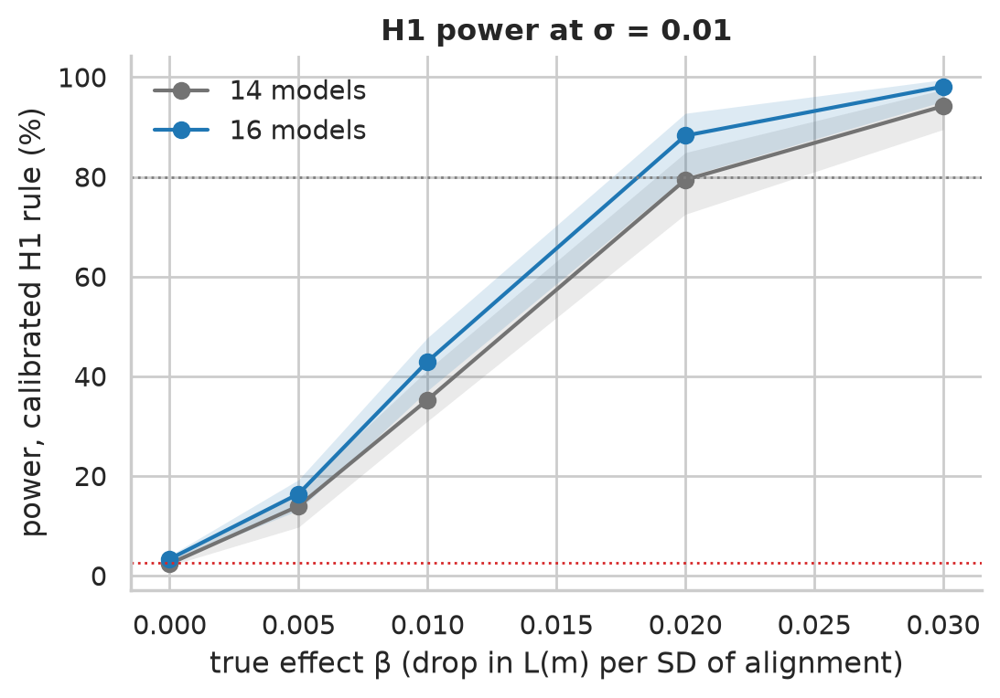

# Sensitivity and validation

Before any real outcome is computed, the study checks three things: that the analysis code does what it should, that the full analysis recovers a known effect and finds none where there is none, and how likely the H1 test is to detect effects of plausible size. None of these checks uses a real trait prediction or leakage value. They use simulated data, human ratings alone, or the model-level predictors.

## Tests built into the analysis

The analysis notebook runs these tests every time. On real data, a failure stops the notebook before H1 is read. The results below are from the synthetic run of 23 November 2026 (fast settings: 5 folds, 1 repeat, 1,999 bootstrap draws).

| Test | What must hold | Result |
|---|---|---|
| Ridge solver | equals the closed-form ridge solution | pass |
| Fold integrity | no evaluation face is ever in a training set, and every main face is predicted exactly once per repeat | pass |
| Estimator under the null | when predictions are the true trait plus independent noise (200,000 simulated faces), L(m) is within ±0.005 of zero and every ELᵢⱼ within ±0.01 | pass: L(m) = −0.0003; largest \|ELᵢⱼ\| = 0.004 |
| Control for the null test | the same test, with the wrong reliability in the correction, must fail | fails as required: largest \|ELᵢⱼ\| = 0.130 |
| Estimator dose–response | injected leakage of 0, 0.05, 0.10 and 0.20 raises L(m) in order | pass: 0.000, 0.006, 0.011, 0.020 |
| Independent re-implementation | a separately written version of the H1 step gives the same coefficient, t, p and robustness coefficients | identical |
| Size of the H1 test | with no effect, the wild cluster test rejects at about the nominal 2.5% (400 simulated outcomes) | 2.2% and 3.5% in the two synthetic runs |

The null and dose–response tests matter most. They show that excess leakage is zero when a model's predictions are only as entangled as the human ratings imply, and that it grows in proportion to added leakage, so the outcome measures what it is meant to measure.

## Validation of the transformation code

H1b retrains Hojjati et al.'s transformation for the extension models, the placebo and the cross-validation, so the training code must reproduce the released matrices. Training is stochastic, so the released matrix is compared with a range of retrained ones rather than a single value. For Dlib and SFace, the code was run on the released training triplets with the published penalties and three random seeds, and the released matrix's alignment (all trials) had to lie within the retrained range, ±0.01. Both passed (24 November 2026).

| Model | Raw embedding | Released matrix | Retrained, 3 seeds |
|---|---|---|---|
| Dlib | 0.3208 | 0.3947 | 0.3944–0.3962 |
| SFace | 0.1958 | 0.3720 | 0.3717–0.3723 |

The check uses similarity data only and involves no social rating.

## Synthetic recovery

In synthetic mode, the notebook builds a simulated world that keeps the real faces, face sets, demographics, reliabilities and trait structure, but replaces the embeddings and ratings with simulated ones.

- Each face has 20 latent traits with the human correlation structure. Ratings are the latent traits plus rating noise at each trait's real reliability.
- Each model's embedding carries a general factor shared by all traits and trait-specific information whose strength varies by model; weaker trait-specific information produces leakage. The models keep their real embedding sizes, alignment, recognition accuracy and families.
- A parameter κ ties the strength of trait-specific information to alignment, building in an H1 effect of known size.

| Check | Criterion | Result |
|---|---|---|
| Estimated against true L(m) (10,000 fresh faces per model) | rank correlation across models ≥ 0.8 | 1.00; mean bias +0.004, the same for every model |
| Built-in effect (κ = 0.6) | H1 supported | supported: b = −0.013, p = 0.005; all leave-one-family-out and hold-out coefficients negative |
| No effect (κ = 0) | H1 not supported | not supported: b = −0.001, p = 0.35; leave-one-family-out coefficients from −0.002 to +0.001 |

The synthetic world tests the code and the decision rule. It says nothing about what the real data will show. In synthetic mode H1b uses a stand-in transformation, so its synthetic results test only the code path.

## Power of the H1 test

The power of H1 was estimated by simulation, using the real alignment, recognition accuracy and families of the 16 models.

**Design.** Outcomes were simulated as L(m) = −β · z(alignment) − 0.005 · z(trait accuracy) + family effect + model effect + estimation noise. β is the drop in L(m) per standard deviation of alignment. The estimation noise had a standard deviation of 0.004 on the main set and 0.0066 on the hold-out, correlated 0.5 across models. The grid varied the model-level standard deviation σ (0.005, 0.01, 0.02), the share of that variance at the family level (0, 0.3, 0.6), the correlation between alignment and trait accuracy (0, 0.3, 0.6) and β (0 to 0.03). Each cell had 800 simulated studies with 499 bootstrap draws each.

**False positives.** With no effect, the full H1 rule was satisfied in 3.1% of simulated studies with 16 models (2.6% with 14), averaged over the grid. The rule is slightly liberal relative to the nominal 2.5%.

**Power,** averaged over family share and trait-accuracy correlation (worst case in brackets):

| σ | Models | β = 0.005 | β = 0.01 | β = 0.02 | β = 0.03 |
|---|---|---|---|---|---|
| 0.005 | 16 | 38% (29) | 84% (76) | 99% (98) | 100% (100) |
| 0.01 | 16 | 16% (13) | 43% (37) | 88% (80) | 98% (95) |
| 0.02 | 16 | 8% (7) | 17% (13) | 45% (36) | 75% (66) |
| 0.01 | 14 | 14% (10) | 35% (31) | 79% (72) | 94% (90) |

*Figure 1. Power of the H1 decision rule at σ = 0.01 with the 14 core models and with all 16. Bands show the range over family share and trait-accuracy correlation; the dotted lines mark 80% power and the nominal 2.5% false-positive rate.*

**Reading.** The study is well powered only if models vary little beyond what the predictors explain (σ around 0.01) and the effect is at least β ≈ 0.02. If model-level variation is larger, power stays below 50% even for that effect. A result that does not support H1 is therefore a realistic outcome, and it will not be read as evidence that alignment and excess leakage are unrelated.

**Omitted confounders.** A model-level property correlated with alignment that also lowers excess leakage would raise the false-positive rate: to 3.3% at a correlation of 0.3 and 6.5% at 0.6, for an effect half the size of σ (14 models). With one observation per model, this limit cannot be removed by design, and it is why H1 is not interpreted causally.
